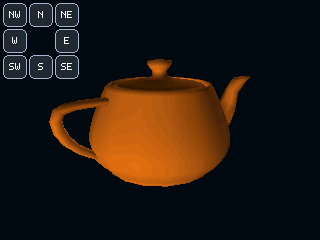

# MiniMesa32 – Utah Teapot auf dem ESP32

Ein kompakter, Mesa/OpenGL-artiger Software-Renderer fuer den klassischen
**ESP32-WROOM-32** mit einem **ILI9341-Touchdisplay (320 x 240)**.
Die Demo zeigt einen orangefarbenen Utah Teapot mit Beleuchtung, Perspektive
und Z-Puffer. Acht Touch-Tasten drehen das Modell schrittweise.

## Screenshot / Vorschau



PC-gerenderte Vorschau, 320 x 240 Pixel, X=15 und Y=30 Grad. Die 3D-Darstellung
wurde mit dem unveraenderten Projekt-Renderer erzeugt. Die Display-API und die
Tastenbeschriftung werden fuer die Vorschau durch einen kleinen Desktop-Adapter
ersetzt. Dies ist kein Foto und kein vom ESP32 ausgelesener Screenshot.
[Vorschau reproduzieren](tools/preview/README.md).

## Funktionen

- Immediate-Mode-API: `glBegin(MM_TRIANGLES)`, `glNormal3f()`, `glVertex3f()`, `glEnd()`.
- ModelView- und Projektionsmatrix, Translation, Rotation, Skalierung und Perspektive.
- RGB565-Rasterisierung, Software-Z-Puffer und interpolierte Helligkeit.
- Speichersparendes Band-Rendering mit jeweils 16 Displayzeilen.
- Utah Teapot aus 32 bicubischen Bezier-Patches; Tessellation 4 ergibt 1024 Dreiecke.
- Statisches Tastenfeld: Die oberen linken 82 x 82 Pixel werden vom Renderer
  ausgespart, damit die Bedienelemente nicht bei jedem Bild geloescht werden.
- Korrigierte RGB565-Bytefolge durch `tft.setSwapBytes(true)`.

MiniMesa32 ist eine eigenstaendige kleine Implementierung mit aehnlichen
Funktionsnamen, **keine Portierung von Mesa und keine vollstaendige OpenGL-Implementierung**.
Der aktuelle Renderer ist fuer diese Demo ausgelegt: maximal 1152 Dreiecke,
320 Pixel breite Baender, kein allgemeines Near-Plane-Clipping und keine
inverse transponierte Normalenmatrix fuer nichtuniforme Skalierung.
Die Beleuchtung verwendet den Betrag des Skalarprodukts (beidseitige Beleuchtung).

## Hardware

| Anschluss | ESP32 GPIO |
| --- | ---: |
| TFT MISO / SDO | 19 |
| TFT MOSI / SDI | 23 |
| TFT SCLK | 18 |
| TFT CS | 15 |
| TFT DC | 2 |
| TFT RST | 4 |
| Touch CS (XPT2046) | 32 |

Display und Touch teilen sich den SPI-Bus. Gemeinsame Masse und eine zum
Displaymodul passende Versorgung sind erforderlich. SPI-Takt: 27 MHz fuer das
Display, 2,5 MHz fuer Touch. Anzeige-Rotation: `1` (Querformat).

## Installation

1. Dieses Repository herunterladen oder klonen:

   ```sh
   git clone https://github.com/basti0772/minimesa32.git
   cd minimesa32
   ```

2. Arduino IDE oder Arduino CLI installieren. Boardpaket `esp32` von Espressif
   und Bibliothek `TFT_eSPI` von Bodmer installieren. Der bisher getestete Stand:
   ESP32-Core **3.3.12**, TFT_eSPI **2.5.43**.

3. TFT_eSPI konfigurieren: Die vorhandene `User_Setup.h` im installierten
   TFT_eSPI-Bibliotheksordner zuerst sichern und anschliessend durch
   [`MiniMesa32_Teapot/config/User_Setup.h`](MiniMesa32_Teapot/config/User_Setup.h)
   ersetzen. `User_Setup_Select.h` muss dieses Setup einbinden (Standard).
   Die Datei im Projekt wird von TFT_eSPI **nicht automatisch geladen**.
   Diese Bibliothekseinstellung wirkt auch auf andere TFT_eSPI-Projekte.

4. In der Arduino IDE `MiniMesa32_Teapot/MiniMesa32_Teapot.ino` oeffnen,
   **ESP32 Dev Module** und den angeschlossenen Port auswaehlen, dann hochladen.

Alternativ mit Arduino CLI, vom Repository-Verzeichnis aus:

```powershell
arduino-cli compile --fqbn esp32:esp32:esp32 .\MiniMesa32_Teapot
$espPort = powershell -ExecutionPolicy Bypass -File .\MiniMesa32_Teapot\Find-ESP32Port.ps1
arduino-cli upload -p $espPort --fqbn esp32:esp32:esp32 .\MiniMesa32_Teapot
powershell -ExecutionPolicy Bypass -File .\MiniMesa32_Teapot\Read-Serial.ps1 -Seconds 10
```

Oder `MiniMesa32_Teapot/Build-And-Flash.ps1` ausfuehren. Bei mehreren seriellen
Boards den Port explizit ueber `-Port COMx` angeben und vorab kontrollieren.
Der mitgelieferte Erkennungshelfer waehlt den ersten passenden Port.

[Eigenstaendiges Arduino-Projekt als ZIP herunterladen](MiniMesa32_Teapot.zip).
TFT_eSPI und der ESP32-Core sind externe Abhaengigkeiten und nicht im ZIP enthalten.

## Bedienung und Touch-Kalibrierung

Nach dem Start dreht sich der Teapot automatisch. Die erste gueltige
Tastenberuehrung stoppt die Automatik. `N`/`S` aendern X um -/+45 Grad,
`W`/`E` aendern Y um -/+45 Grad. Die Diagonaltasten aendern beide Achsen
jeweils um 45 Grad; dies ist keine einzelne 45-Grad-Drehung um eine diagonale Achse.
Vor dem naechsten Tastendruck loslassen. Ein Neustart aktiviert die Automatik wieder.

Der Sketch uebernimmt, falls vorhanden, die auf dem bisherigen Aufbau gespeicherte
affine Touch-Kalibrierung aus NVS (`chess-touch`, Schluessel `rot3-v1`) und
rechnet sie von Display-Rotation 3 auf Rotation 1 um. Ohne diese Daten nutzt er
eine feste Rohwertzuordnung (200 bis 3900, Achsen vertauscht). Diese ist
hardwareabhaengig: Treffen Beruehrungen die Tasten nicht, muss
`readTouchPosition()` an das Display angepasst werden. Eine eigene
Kalibrierungsoberflaeche ist in diesem Projekt noch nicht enthalten.

## Projektinhalt

- `MiniMesa32_Teapot/`: vollstaendiger Arduino-Sketch, Renderer, Bezier-Modell,
  Displaykonfiguration, PowerShell-Helfer und FreeGLUT-Lizenz.
- `MiniMesa32_Teapot.zip`: separat entpackbarer Arduino-Projektordner.
- `docs/teapot-preview.png`: eingebundene Vorschau.
- `tools/preview/`: reproduzierbarer Desktop-Renderlauf mit unveraendertem Sketch.

## Bisherige Hardwarepruefung

Die Version mit flackerfreiem Tastenfeld wurde am 30.09.2026 mit Arduino CLI
kompiliert, auf einem ESP32-D0WDQ6 geflasht und seriell geprueft:
328304 Byte Flash, 113372 Byte statischer RAM, 1024 Dreiecke,
173–177 ms pro Bild und konstant 213464 Byte freier Heap.
Das sind Messwerte des damaligen Aufbaus, keine garantierten Leistungswerte.

## Herkunft und Lizenzhinweise

Die Teapot-Kontrolldaten stammen aus
[FreeGLUT](https://github.com/freeglut/freeglut/blob/master/src/fg_teapot_data.h).
Der zugehoerige Lizenztext liegt in
[`FREEGLUT-LICENSE.txt`](MiniMesa32_Teapot/FREEGLUT-LICENSE.txt).
TFT_eSPI und das ESP32-Boardpaket unterliegen ihren eigenen Lizenzen.
Fuer den projektspezifischen Code wurde bislang keine separate Lizenz festgelegt.
